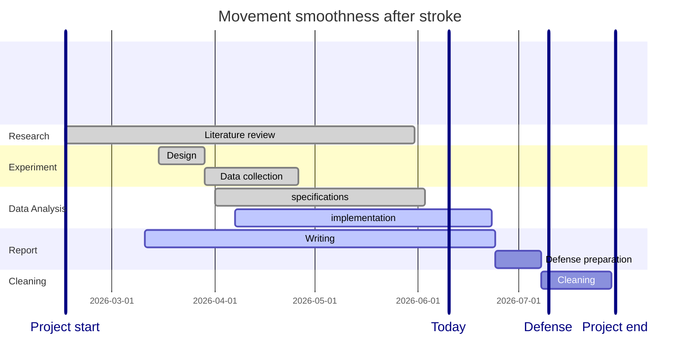

## Month #04 - June 2026

**Student:** Nolwen LI
**Project Period:** 18 May 2026 - 12 June 2026 - Month #04
**Supervisor:** Prof. Denis MOTTET

### Work Progress

* Task #5.3: Data analysis pipeline for a collection of patients 
  * Used the detailed specifications (task #4.3) to implement the main data analysis notebook and functions (initial tests only). Took about 15 days. 
  * Next Steps: Conduct further testing , and finalize integration with other components.

* Task #5.4: Create figures for the report
  * Created all figures for the report, including plots and visualizations. Took about 4 days.
  * Next Steps: Select figures to include in the report, and finalize figure formatting.

* Task #6: Report writing
  * Updated the report with the latest results and progress. Took about 7 days.
  * Next Steps: Finalize the report, focusing on the discussion and conclusion sections.

### Skills and Learning
* Improved my data analysis and coding skills in Python and R, particularly in terms of data manipulation and visualization using ggplot2.
* Gained experience in creating scientific reports including informative visualizations of complex results in relation to the research hypothesis.

### Issues and Support Needed
* Need feedback on the data analysis pipeline and the figures created for the report (especially regarding Fig 5: we need to improve it or do it differently) and suggestions on the best way to finalize the report.
* Need guidance on the best practices for cleaning and organizing project outcomes for future use.

### Plan for last month of the project
* Finalize the report and submit it before the defense.
* **Critical:** Cleaning my project outcomes for re-use in future projects. At least 2-3 weeks seem necessary for this task, including tests with other students in the lab to ensure quality.

* If time permits:
    * Conduct further testing in Task #5.3 (integration with other components).
